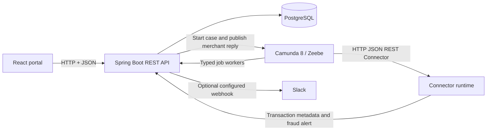
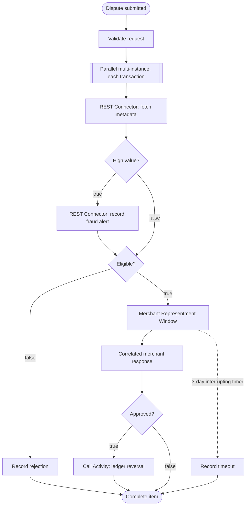

<div align="center">

# MULTI-TRANSACTION
# CHARGEBACK AUTOMATION

### One claim. Every transaction. A clear path to resolution.

<strong>Camunda 8 · Spring Boot · React · PostgreSQL</strong>

<br />

Banking and Financial Services · Project Idea 3 · Academic demonstration

</div>

---

> A customer can select multiple questionable statement lines and raise one dispute. Camunda coordinates independent transaction evaluation, merchant representment, a response deadline, fraud alerts, and ledger reversals for approved items.
>
> **Safety:** This project uses simulated records and does not process real cardholder, payment, or banking data.

## At a glance

| Area | What is implemented |
|---|---|
| Customer portal | React statement selection, multi-line claims, tracking, Tasklist, and fraud desk |
| Application API | Spring Boot REST endpoints with JSON responses and explicit HTTP statuses |
| Persistence | PostgreSQL for Compose/deployment; H2 for automated tests and the local demo profile |
| Workflow | Camunda 8 process with parallel multi-instance transaction evaluation |
| Integrations | Camunda HTTP JSON REST Connector for transaction metadata and fraud alerts |
| Human response | Correlated merchant response message and interrupting three-day timer |
| Recovery | BPMN error boundaries and a reusable ledger-reversal Call Activity |
| Packaging | Backend/frontend Dockerfiles and a root Docker Compose stack |

## Product experience and design direction

The portal is designed as a calm, editorial fintech workspace: warm paper surfaces, deep botanical green, restrained terracotta accents, generous typography, clear data tiles, and a compact sticky menu. A small motion-led transaction illustration and scrolling project ribbon add character without competing with the task. Animations respect `prefers-reduced-motion`; the interface adapts for phone, tablet, and desktop.

The visual direction was informed by finance and interaction examples indexed by [Awwwards](https://www.awwwards.com/websites/finance/) and [Lapa Ninja](https://www.lapa.ninja/category/finance/). These are inspiration references, not copied layouts or assets. The hero illustration is built from CSS and sample transaction values; it does not use customer data or generated imagery.

The **About** view introduces the student project team and their documented areas of focus. It also makes clear that this academic prototype is not affiliated with Capital One.

## Screens and workflow

The portal has five focused views: **Statement**, **Tracking**, **Tasklist**, **Fraud desk**, and **About**. The statement view supports a single multi-transaction claim; tracking presents line-level decisions, the Tasklist handles merchant responses, and the fraud desk surfaces high-value items.





Transaction lines are evaluated in parallel because their metadata, eligibility, and merchant decisions are independent. There is no ordering dependency between a customer's selected statement lines. The main BPMN model uses explicit boolean conditions on every exclusive-gateway branch.

## BPMN and decision dictionary

| Element | FEEL / mapping | Behavior |
|---|---|---|
| Multi-instance collection | `=transactions` | Creates one parallel token per submitted dispute line |
| High-value route | `=highValue = true` | Sends the item through the fraud-alert REST Connector |
| Standard-value route | `=highValue = false` | Continues to eligibility evaluation |
| Eligible route | `=eligible = true` | Enters the merchant-response subprocess |
| Ineligible route | `=eligible = false` | Records a rejection and skips ledger reversal |
| Approved route | `=approved = true` | Calls `core-banking-ledger-reversal` |
| Rejected route | `=approved = false` | Ends the item without a refund |
| Metadata URL | `=transactionApiBaseUrl + "/api/transactions/" + transaction.transactionId` | Fetches metadata for the active multi-instance item |
| Merchant timer | `=duration(merchantTimeout)` | Interrupts the response wait when the configured duration expires |
| Ledger call inputs | `=caseId`, `=transaction.itemId`, `=transaction.transactionId` | Scopes identifiers into the child process |

The metadata and fraud tasks use the Camunda HTTP JSON REST Connector template `io.camunda.connectors.HttpJson.v2` (version 11), with task type `io.camunda:http-json:1` and modeler connector markers. The fraud connector records an alert through the application API. If `SLACK_WEBHOOK_URL` is configured, the backend optionally forwards that alert to Slack; the webhook is not a second native Camunda connector.

Business errors use `ZeebeBpmnError` and BPMN error boundaries for invalid requests, metadata evaluation, and ledger reversal. A boundary timer handles merchant timeout. The `P3D` response deadline can be shortened for demonstrations.

## REST API: request and response

All successful endpoints return JSON where a response body is defined. The key integration contracts are:

| Request | Successful response |
|---|---|
| `GET /api/transactions/{id}` | `200 OK` with transaction metadata JSON; consumed by the metadata connector |
| `POST /api/disputes` | `201 Created`, `Location: /api/disputes/{id}`, and the created case JSON |
| `POST /api/fraud/alerts` | `202 Accepted` and a JSON body containing `recorded` and `slackNotificationStatus` |
| `POST /api/disputes/{caseId}/transactions/{itemId}/merchant-response` | `202 Accepted` and `{"status":"correlated"}` after Camunda accepts the message |
| Invalid request or missing record | `400 Bad Request` with an `error` field |
| Workflow action without an available Camunda client | `503 Service Unavailable` with an `error` field |

Example multi-line request:

```json
{
  "customerId": "customer-001",
  "items": [
    { "transactionId": "txn-amazon", "reason": "FRAUD" },
    { "transactionId": "txn-flipkart", "reason": "DUPLICATE" }
  ]
}
```

Example accepted fraud-alert response:

```json
{
  "recorded": true,
  "slackNotificationStatus": "NOT_CONFIGURED"
}
```

Allowed dispute reasons: `FRAUD`, `MERCHANDISE_NOT_RECEIVED`, and `DUPLICATE`.

| Method | Route | Purpose |
|---|---|---|
| `GET` | `/api/transactions` | List statement lines |
| `GET` | `/api/transactions/{id}` | Return transaction metadata for the REST Connector |
| `POST` | `/api/disputes` | Create one dispute for multiple lines |
| `GET` | `/api/disputes` | List cases and item results |
| `GET` | `/api/disputes/{id}` | Retrieve a case |
| `GET` | `/api/disputes/{id}/transactions` | Retrieve line-level decisions and refund results |
| `GET` | `/api/tasklist` | List items awaiting merchant responses |
| `POST` | `/api/disputes/{caseId}/transactions/{itemId}/merchant-response` | Publish a correlated response |
| `POST` | `/api/fraud/alerts` | Validate and record a high-value alert |
| `GET` | `/api/refunds/{itemId}` | Retrieve a line's refund result |
| `GET` | `/api/dashboard/summary` | Return dashboard counts |

Full payloads and endpoint details are in [the API reference](docs/api-documentation.md).

## Run locally

### Prerequisites

- Java 21 and Maven
- Node.js and npm
- Docker Desktop for the PostgreSQL Compose setup
- A reachable Camunda 8 cluster and HTTP JSON Connector runtime to execute BPMN workflows

### Application and database

1. Copy `.env.example` to `.env`; choose a local PostgreSQL password.
2. From the repository root, run `docker compose up --build`.
3. Open the portal at `http://localhost:5173`; the API listens on `http://localhost:8080`.

The Compose stack starts PostgreSQL, the API, and the static frontend. It does **not** bundle a Camunda engine or Connector runtime. Workflow execution is disabled by default; the UI and API can be explored without claiming live workflow execution.

### Enable Camunda workflows

1. Deploy both BPMN files from `bpmn-models/` to a compatible Camunda 8 cluster.
2. Configure the Spring Boot Camunda REST and Zeebe gRPC addresses.
3. Run a compatible HTTP JSON Connector runtime that can reach the backend.
4. Set `APP_WORKFLOW_ENABLED=true`.
5. Set `TRANSACTION_API_BASE_URL` to the backend URL as seen from the connector runtime (for example, `http://backend:8080` from Docker networking).
6. To enable the optional Slack relay, set `SLACK_WEBHOOK_URL` in the backend environment. Keep webhook values private; do not commit them.
7. For a short classroom timer, set `DEMO_TIMEOUT=PT30S`. The default is `P3D`.

### Run a local API and UI simulation (no Docker required)

The `local` Spring profile uses an in-memory H2 database and keeps Camunda workflow execution disabled. It starts the real Spring Boot REST API with the sample statement records, so the React screens and API contracts can be exercised together. The database is temporary and resets when the API stops; this profile is for development and demonstrations only.

In one terminal, from the repository root:

```shell
mvn -f backend-springboot/pom.xml spring-boot:run -Dspring-boot.run.profiles=local
```

In a second terminal:

```shell
cd frontend-react
npm ci
npm run dev
```

Open `http://localhost:5173`. The Vite development server proxies `/api` requests to `http://localhost:8080`. Creating and tracking claims, loading sample transactions, and recording fraud-alert API responses can be demonstrated. Merchant replies that require a running Camunda engine return an explicit `503`; no simulated response is presented as a completed workflow. To test merchant decisions, timers, ledger reversal, and connectors end to end, use the PostgreSQL Compose stack with a deployed Camunda 8 cluster and Connector runtime.

For frontend-only development, `npm ci` and `npm run dev` in `frontend-react` are sufficient. Automated backend tests use H2 and issue real HTTP requests against a random local port.

## Configuration

| Variable | Default | Description |
|---|---|---|
| `POSTGRES_DB` | `chargeback` | Compose PostgreSQL database |
| `POSTGRES_USER` | `chargeback` | Compose PostgreSQL user |
| `POSTGRES_PASSWORD` | `change-me` | Local-only example; set a private password |
| `APP_WORKFLOW_ENABLED` | `false` | Starts a Camunda process when true |
| `CAMUNDA_CLIENT_REST_ADDRESS` | `http://host.docker.internal:8088` in Compose | Camunda REST endpoint |
| `CAMUNDA_CLIENT_ZEEBE_GRPC_ADDRESS` | `http://host.docker.internal:26500` in Compose | Zeebe gateway endpoint |
| `TRANSACTION_API_BASE_URL` | `http://backend:8080` in Compose | Backend base URL reachable by the connector |
| `DEMO_TIMEOUT` | `P3D` | Merchant response duration in ISO-8601 format |
| `HIGH_VALUE_THRESHOLD` | `4000` | Amount at or above which an alert is raised |
| `SLACK_WEBHOOK_URL` | Empty | Optional private Slack incoming webhook |

Configuration details and setup troubleshooting: [setup guide](docs/setup-guide.md).
The local `application-local.yml` profile sets H2 and disables Camunda for explicit local simulation; Docker Compose continues to supply PostgreSQL settings.

## Verification

Run the application checks:

```powershell
# Backend build, tests, and package
mvn -f backend-springboot/pom.xml verify

# Frontend behavior tests and production build
cd frontend-react
npm ci
npm test
npm run build
```

Frontend tests cover multi-transaction submission, merchant response submission, API validation feedback, navigation, and the About view. Backend HTTP integration tests exercise JSON request/response behavior and `200`, `201`, `202`, `400`, and `503` status outcomes using an embedded H2 database. The BPMN source and backend resource copies are kept identical.

These automated checks do not deploy BPMN or start Camunda. Confirm deployed process instances, connector outcomes, timer paths, and error boundaries in Camunda Operate before presenting engine-run evidence. See [the testing guide](docs/testing-guide.md).

## Submission readiness

| Guideline deliverable | Current repository evidence |
|---|---|
| Main BPMN process, child ledger process, gateways, FEEL, and mappings | `bpmn-models/` and [workflow explanation](docs/bpmn-workflow-explanation.md) |
| Parallel multi-instance, merchant subprocess, timer, error boundaries, and Call Activity | Main BPMN model; execution still requires Camunda |
| Spring REST API, persistence, typed workers, business-error handling | `backend-springboot/` |
| React statement portal, Tasklist, tracker, and user feedback | `frontend-react/` |
| Dockerfiles and Compose configuration | Root `docker-compose.yml`, plus service Dockerfiles |
| API, schema, setup, testing, architecture, and viva documentation | `docs/` |
| Approximately 20-page report and genuine application/Operate screenshots | **Separate submission deliverable; not included. Capture from the running environment rather than fabricate evidence.** |
| Live Camunda deployment and end-to-end execution evidence | **Requires a configured Camunda 8 cluster and Connector runtime; not verified by local automated tests.** |

The report should follow the prescribed seven-chapter structure: executive summary/use case; BPMN architecture/failure handling; system architecture/technology; data contracts/API; Docker/deployment; testing/evidence; team contributions/conclusion. See the submission guidelines supplied with the project.

## Repository map

```text
backend-springboot/  Spring Boot API, persistence, workers, tests, BPMN runtime resources
bpmn-models/         Main chargeback process and reusable ledger reversal process
docs/                Architecture, API, database, setup, testing, workflow, and viva guides
frontend-react/      React portal, styles, behavior tests, and Vite configuration
docker-compose.yml   PostgreSQL + API + frontend orchestration
```

## Team

| Member | Focus |
|---|---|
| Dito Dileep | BPMN architecture, Camunda integration, deployment, and implementation |
| Adithya R Nath | Spring Boot APIs, React interface, REST integration, and testing |

## Project documentation

- [Architecture](docs/architecture.md)
- [REST API reference](docs/api-documentation.md)
- [BPMN workflow explanation](docs/bpmn-workflow-explanation.md)
- [Database schema](docs/database-schema.md)
- [Setup guide](docs/setup-guide.md)
- [Testing guide](docs/testing-guide.md)
- [Viva questions](docs/viva-questions.md)
