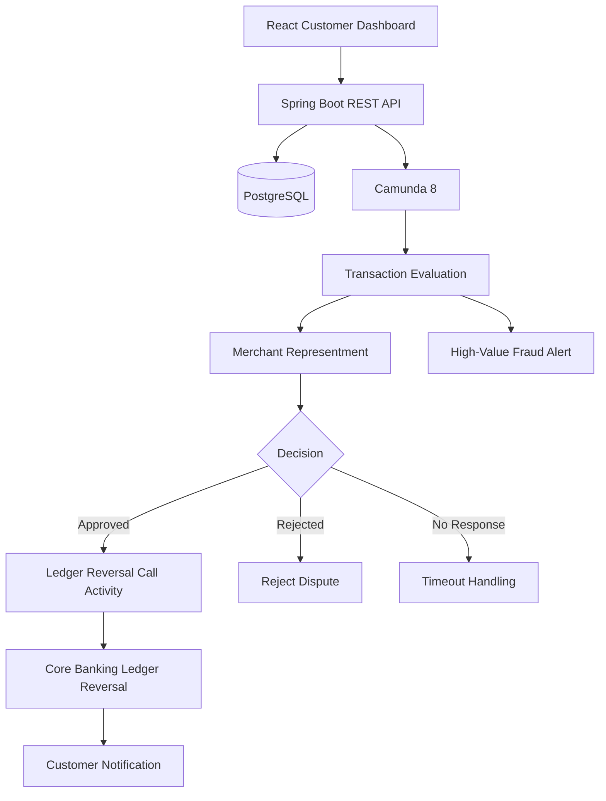
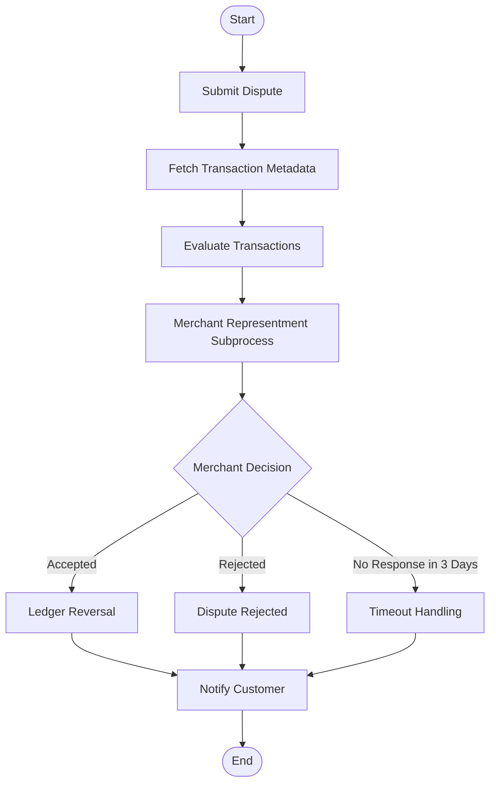

<div align="center">

# MULTI-TRANSACTION
# CREDIT CARD CHARGEBACK AUTOMATION

**A banking dispute management workflow powered by Camunda 8**

<br/>


<br/>

[Overview](#overview) · [Architecture](#architecture) · [Workflow](#workflow) · [Technology](#technology) · [Setup](#getting-started)

</div>

---

## Overview

A customer may identify multiple unauthorized or incorrect transactions on a single credit card statement. Handling each transaction as a separate dispute creates unnecessary complexity.

This project introduces a **multi-transaction chargeback automation system** where customers can submit multiple disputed transactions through a single claim.

Camunda 8 orchestrates the dispute lifecycle, evaluates each transaction independently, manages merchant response deadlines, and triggers ledger reversals for approved disputes.

> Built as an academic demonstration using simulated banking data. No real cardholder or payment information is processed.

## Core Capabilities

| Capability | Description |
|---|---|
| Multi-transaction claims | Submit multiple disputed transactions in one request. |
| Parallel evaluation | Evaluate each transaction independently using multi-instance BPMN. |
| Merchant representment | Manage merchant response through an embedded subprocess. |
| Deadline management | Enforce a three-day response window using a boundary timer. |
| Ledger reversal | Invoke a reusable banking reversal process through a Call Activity. |
| Transaction metadata | Retrieve transaction information through a REST-style integration worker. |
| Fraud monitoring | Trigger configurable alerts for high-value disputes. |

## Architecture



## Workflow

The main BPMN process coordinates the complete dispute lifecycle.



### BPMN Concepts Demonstrated

- **Parallel Multi-Instance:** Processes multiple disputed transaction line items independently.
- **Embedded Subprocess:** Encapsulates the merchant representment stage.
- **Boundary Timer Event:** Handles the three-day merchant response deadline (`P3D`).
- **Call Activity:** Invokes the reusable Core Banking Ledger Reversal process.
- **Decision Gateways:** Directs transactions through approval, rejection, and timeout paths.

## Technology

| Layer | Technology |
|---|---|
| Workflow orchestration | Camunda 8 |
| Backend | Java, Spring Boot |
| Frontend | React, Vite |
| Database | PostgreSQL |
| Workflow models | BPMN 2.0, DMN |
| Integration | REST-style Java job workers |
| Containerization | Docker, Docker Compose |
| Testing | JUnit, H2 |

## Project Structure

```text
credit-card-chargeback-automation/
│
├── backend-springboot/
│   ├── src/
│   │   ├── main/
│   │   │   ├── java/
│   │   │   └── resources/
│   │   └── test/
│   ├── Dockerfile
│   └── pom.xml
│
├── frontend-react/
│   ├── src/
│   │   ├── assets/
│   │   ├── main.jsx
│   │   └── style.css
│   ├── Dockerfile
│   └── package.json
│
├── bpmn-models/
│   ├── chargeback-process.bpmn
│   ├── ledger-reversal-process.bpmn
│   └── dispute-rules.dmn
│
├── docs/
│   ├── architecture.md
│   ├── api-documentation.md
│   ├── bpmn-workflow-explanation.md
│   ├── database-schema.md
│   ├── setup-guide.md
│   ├── testing-guide.md
│   └── viva-questions.md
│
├── .env.example
├── docker-compose.yml
└── README.md
```

## Getting Started

### Prerequisites

- Java 17 or compatible version configured in the project
- Maven
- Node.js and npm
- Docker Desktop
- Camunda 8 environment for executable workflow deployment

### 1. Clone the repository

```bash
git clone https://github.com/dito-dileep/credit-card-chargeback-automation.git

cd credit-card-chargeback-automation
```

### 2. Configure environment variables

Copy the example environment file:

```bash
cp .env.example .env
```

Update the database credentials and other required configuration.

### 3. Start the application

```bash
docker compose up --build
```

### 4. Open the application

| Service | URL |
|---|---|
| React Dashboard | http://localhost:5173 |
| Spring Boot API | http://localhost:8080 |

**Camunda deployment:** Start a compatible Camunda 8 environment separately, deploy the BPMN and DMN models from `bpmn-models/`, and configure the Zeebe connection settings.

For local development and additional configuration, refer to [`docs/setup-guide.md`](docs/setup-guide.md).

## Demonstration Scenarios

The application includes seeded mock transactions to demonstrate different dispute outcomes.

| Transaction | Amount | Expected Scenario |
|---|---:|---|
| Amazon | ₹2,000 | Approval |
| Subscription Streaming | ₹499 | Rejection |
| NoReply Electronics | ₹1,200 | Merchant timeout |
| Flipkart | ₹5,000 | High-value fraud alert |
| Unknown Transaction | — | Invalid input handling |

## Testing

**Backend**

```bash
cd backend-springboot
mvn test
```

**Frontend**

```bash
cd frontend-react
npm install
npm run build
```

Additional workflow scenarios and manual verification steps are documented in [`docs/testing-guide.md`](docs/testing-guide.md).

## Team

| Member | Responsibilities |
|---|---|
| **Dito Dileep** | BPMN architecture, Camunda integration, workflow deployment and project implementation |
| **Adithya R Nath** | Spring Boot APIs, React interface, REST integration and testing |

Both members contribute to integration, testing, documentation and the final demonstration.

## Documentation

| Document | Description |
|---|---|
| [Architecture](docs/architecture.md) | System architecture and component design |
| [API Documentation](docs/api-documentation.md) | Backend endpoints and API details |
| [BPMN Explanation](docs/bpmn-workflow-explanation.md) | Workflow structure and BPMN concepts |
| [Database Schema](docs/database-schema.md) | Database structure |
| [Setup Guide](docs/setup-guide.md) | Installation and configuration |
| [Testing Guide](docs/testing-guide.md) | Testing procedures |
| [Viva Questions](docs/viva-questions.md) | Project discussion and preparation |

## Limitations

This is a simulated banking workflow intended for academic demonstration.

- Uses mock transaction and customer data.
- Does not connect to real banking systems or payment networks.
- High-value alerts use a configurable worker rather than a guaranteed production Slack/Teams integration.
- Transaction metadata retrieval is implemented through a Java job worker, not a native Camunda REST Outbound Connector.
- The production merchant response deadline is configured as `P3D`. A separate demonstration model can use `PT30S` for a shorter classroom demonstration.

---

<div align="center">

**CAMUNDA 8 · BANKING AUTOMATION · BPMN 2.0**

*Automating dispute resolution, one transaction at a time.*

</div>
