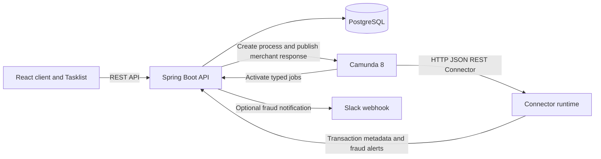

# Architecture

The React client communicates with the Spring Boot REST API. The API validates customer ownership, supported dispute reason, uniqueness, and prior-dispute state, then persists a case and its items in PostgreSQL. With `APP_WORKFLOW_ENABLED=true`, it starts `chargeback-dispute` and stores the Camunda process-instance key.

The process validates its input and creates one parallel multi-instance token per transaction. Each token calls the Spring transaction metadata endpoint using the official Camunda HTTP JSON REST Connector. A typed Spring `@JobWorker` evaluates the returned metadata and the configured threshold. High-value items route through a second REST Connector call to the fraud-alert API; that endpoint records the alert and optionally sends a configured Slack webhook.

Eligible items wait for a merchant response in an embedded subprocess. The interrupting timer records a rejection on expiry; the custom frontend Tasklist publishes correlated responses to the active Camunda message subscription. An accepted response alone invokes the reusable `core-banking-ledger-reversal` process. The child process updates the refund state; a `ZeebeBpmnError` from the worker is caught by the Call Activity's error boundary and recorded as a failed reversal.

Compose runs PostgreSQL, the API, and the static frontend. Camunda 8 and its outbound Connector runtime are external prerequisites and must be started and configured separately. Workflow mode is disabled by default so the Compose stack does not claim to run workflows when no engine is present.

